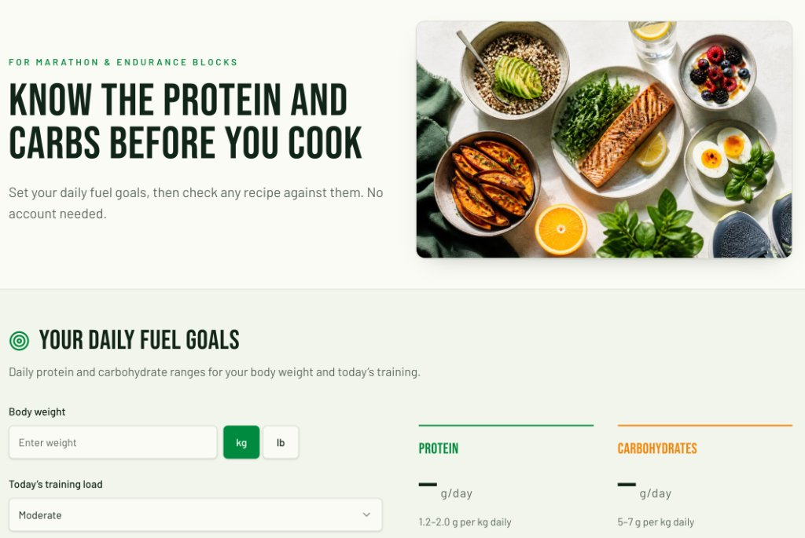

# Plate Math — Macro-Aware Nutrition for Endurance Runners

> Full-stack endurance nutrition app with USDA-first recipe analysis, private local recipe storage, and a drag-and-drop weekly meal planner.

[](https://plate-math.lovable.app)



---

## The Problem

Endurance training places rigorous metabolic demands on the body. Sports nutrition research recommends that endurance athletes eat roughly **5–10 g of carbohydrates** and **1.2–2.0 g of protein per kilogram of body weight per day**, scaling with training volume *(Academy of Nutrition and Dietetics, Dietitians of Canada & ACSM, 2016)*.

As a 4-time marathoner, it can be difficult to find the right recipes and keep track of whether I am meeting those targets on a daily and weekly basis. Most cooking sites bury nutrition in a footnote, or skip it entirely.

**Plate Math removes the mental math:**
* **Weight-based daily goals:** Enter body weight and training load to calculate custom protein and carbohydrate targets (computed locally in pure TS; weight is never stored or transmitted).
* **Instant URL recipe analysis:** Paste any cooking link to extract servings, timings, and ingredient lists automatically.
* **USDA reference nutrition:** Matches ingredients against **USDA FoodData Central** to calculate per-serving protein, carbs, calories, and a runner-specific **protein density metric** (g protein per 100 kcal).
* **Interactive weekly planner:** Move per-serving portion cards onto a 7-day schedule to track real daily carb and protein intake.

---

## Engineering Highlights

| Decision | Why It Matters |
| :--- | :--- |
| **Schema.org JSON-LD First** | Extracts structured recipe metadata directly with deterministic parsing (<1ms latency, **0 AI tokens**), falling back to Gemini only for unstructured blogs. |
| **USDA-First Estimation** | Relies on verified USDA FoodData Central reference values, using a single batched AI fallback only for ingredients USDA cannot match. |
| **Local-First Privacy** | Daily goals, saved recipes, and weekly meal plans stay in browser storage (`localStorage`). No account or database sign-in required. |
| **Server-Side Atomic Quota** | Public demo analyses are capped globally at 25/day via a Postgres RPC (`increment_demo_usage`) with service-role security to safeguard shared API quotas against automated abuse. |

---

## Tech Stack

* **Frontend & Server:** [TanStack Start](https://tanstack.com/start) + [TanStack Router](https://tanstack.com/router) (React 19, SSR, full type safety)
* **Data Ingestion:** Direct Fetch / Firecrawl Gateway → Schema.org JSON-LD / Google Gemini fallback → USDA FoodData Central
* **Database & Quotas:** [Supabase](https://supabase.com) (PostgreSQL RPC, service-role functions)
* **Styling:** Tailwind CSS v4 + Radix UI primitives

---

## Run Locally

```bash
# Clone the repository
git clone https://github.com/jds0uza/fuel-your-run-recipes.git
cd fuel-your-run-recipes

# Install dependencies
npm install

# Start the dev server
npm run dev
```

Open [http://localhost:5173](http://localhost:5173) in your browser.
